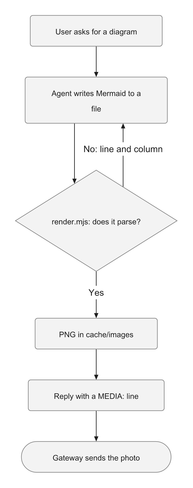

# mermaid-diagram

- **One agent:** [Hermes Agent](https://github.com/NousResearch/hermes-agent), replying in Telegram. Its gateway delivers the same `MEDIA:` line on other chat platforms, but I have tested only Telegram.
- **Local:** a Node script and two npm packages, Pele and resvg, 8 MB installed. No browser and no hosted renderer: rendering sends nothing over the network. The one-time `npm install` is the only network call.
- **No credentials:** it reads the Mermaid file you give it and writes one PNG into Hermes' image cache.

**Ask a Telegram agent for a diagram and you get a code block.** Language models put diagrams in Mermaid by default, and Telegram shows it as text.

This skill has the agent write the Mermaid to a file, render it into a PNG sized for a phone, and reply with the image. Here is a real render by the skill's script:



[Українська версія нижче](#українською)

## What it does

1. **The agent writes the Mermaid to a file.** Hermes can block a long diagram typed straight into a terminal command.
2. **`scripts/render.mjs` lays it out with Pele,** in plain Node. Below 640 px Pele turns a wide left-to-right chart top-to-bottom, so the layout is built for a phone, not shrunk to fit one. Pele measures text with Arial's widths, and the PNG draws it in Liberation Sans, which has the same metrics, so labels stay inside their boxes.
3. **resvg turns it into a PNG** up to about 1440 px wide, inside Telegram's limits for a photo.
4. **A syntax error comes back as a line and a column.** The agent fixes that line and renders again, twice at most, then falls back to a bulleted outline.
5. **The reply carries a `MEDIA:` line,** and the gateway sends the PNG as a photo.

## What I measured

- **Compatibility.** I collected 721 Mermaid blocks from my notes and repos, most of them generated by ChatGPT. Pele drew 711. Mermaid 12.1.0 accepts the same 711 and rejects the same 10: doubled or escaped quotes, a bracket inside an unquoted label, quoted node names. The syntax rules in `SKILL.md` come from those 10.
- **Speed.** In Chrome, Pele took a median 0.5 ms per diagram and Mermaid 26 ms, 0.4 s against 19.5 s for all 711. On my host, one render including the PNG took 0.18 s and peaked at 88 MB of memory.
- **Size.** 8 MB installed. A PNG comes out at 40–85 KB.
- **End to end, once.** I asked by voice, in Ukrainian, how a voice note reaches my daily note. The agent wrote the file, rendered it twice without an error, and the photo arrived with a one-line caption.

One trap, for anyone pairing Pele with resvg: Pele colours everything through CSS variables, and resvg can't resolve them. The raw SVG rasterises as black boxes with no visible text. `render.mjs` substitutes the values first.

## Why this and not something else

- **[Pele](https://pele.run)** by Obsidian (MIT) does all the hard part: parsing, layout, the narrow-screen rules. resvg ([resvg-js](https://github.com/yisibl/resvg-js), MPL-2.0) rasterises. This skill is the glue, plus the rules for drawing on a phone.
- **[mermaid-cli](https://github.com/mermaid-js/mermaid-cli)** draws exactly Mermaid's look and covers every diagram type. It runs a headless Chromium to do it. On a small VPS that is the heavier choice, though I did not measure it there.
- **Hosted renderers** like mermaid.ink or Kroki need no install, but every diagram goes to someone else's server. Mine are about my notes.
- **Hermes' own `excalidraw` and `architecture-diagram` skills** write a file to open somewhere else: excalidraw.com, or a browser. They are the better choice for a diagram you want to edit, or a designed one. Neither puts a picture in the chat.
- **Hand-written SVG** is what my agent did before. It had written itself a skill for it: draw the SVG, convert it with resvg, then check the PNG with a vision model because text kept running out of its boxes. It still wins for a designed one-pager. For a flow of ten boxes, ten lines of Mermaid cost the agent far less, and the layout is computed rather than placed by hand.

## Limits

- **Hermes only, as written.** The `MEDIA:` line and the `$HERMES_HOME` paths are Hermes'. Another agent needs those two changed.
- **Pele is new.** It went public on 6 October 2026 and had 14 releases in its first 13 days. The install command pins 1.6.0.
- **The evidence is mostly flowcharts:** 691 of the 721. There were 13 sequence diagrams, 10 state diagrams and a handful of others. I checked the remaining types on one small example each.
- **It is Pele's look, not Mermaid's.** Mermaid themes don't apply, while `style` and `classDef` do. Labels are plain text: no HTML, and click callbacks are ignored.
- **Latin and Cyrillic only, as tested.** Liberation Sans and DejaVu Sans have no Chinese, Japanese or Arabic glyphs. I have not tried those scripts.
- **A wide diagram gets small text.** A chart that branches four ways can't stack, so it shrinks to fit the width. Telegram lets you zoom into the photo.
- **One end-to-end run.** Rendering was tested on hundreds of diagrams. The whole loop, from question to photo, ran once.
- **Tested on** Hermes Agent 0.20.0, Ubuntu 26.04 on x86_64 (1 vCPU, 2 GB RAM), Node 22.23, replying in Telegram. The script also ran on macOS 26 with Node 26.12.

## Install

On the Hermes host:

```
hermes skills install stan-voo/tools/mermaid-diagram
```

The renderer's packages go outside the skill folder, so a skill update doesn't delete them. Install them once:

```
npm install --ignore-scripts --prefix ~/.hermes/tools/mermaid-diagram pele@1.6.0 @resvg/resvg-js@2.6.2
```

Under a profile, the first render prints the same command with that profile's path. On Debian or Ubuntu, `sudo apt install fonts-liberation` gives you the font the labels are measured for.

Check it from a shell:

```
printf 'flowchart TD\n  A[Hello] --> B[World]\n' > /tmp/t.mmd && node ~/.hermes/skills/mermaid-diagram/scripts/render.mjs /tmp/t.mmd
```

It prints a `MEDIA:` path to the PNG. Then start a new session with `/new`, because Hermes reads its skills when a session starts, and ask for a diagram.

To have the agent draw without being asked, I added one line to my agent's `SOUL.md`:

```
- **Draw it when the shape is the point.** A flow, a sequence, a loop, a decision or how parts connect reads faster as a picture than as bullets: render it with the `mermaid-diagram` skill and send the image. A plain list stays a list, and voice replies stay text.
```

---

## Українською

- **Один агент:** [Hermes Agent](https://github.com/NousResearch/hermes-agent), який відповідає в Телеграмі. Його шлюз (gateway) розуміє такий самий рядок `MEDIA:` і на інших платформах, але я перевіряв лише Телеграм.
- **Локально:** скрипт на Node і два пакети з npm, Pele та resvg, разом 8 МБ. Ні браузера, ні зовнішнього сервісу: рендер нічого не надсилає в мережу. Єдиний мережевий запит — одноразовий `npm install`.
- **Жодних облікових даних:** скрипт читає файл Mermaid, який ви йому дали, і записує один PNG у кеш зображень Hermes.

**Попросіть агента в Телеграмі намалювати діаграму, і отримаєте блок коду.** За замовчуванням мовні моделі видають діаграми в Mermaid, а Телеграм показує його як текст.

З цим скілом агент записує Mermaid у файл, перетворює його на PNG під розмір телефона й відповідає картинкою. Зображення вище — справжній результат скрипта.

## Що він робить

1. **Агент записує Mermaid у файл.** Довгу діаграму, вписану просто в команду терміналу, Hermes може заблокувати.
2. **`scripts/render.mjs` розкладає її за допомогою Pele**, у звичайному Node. Якщо ширина менша за 640 пікселів, Pele перебудовує широку горизонтальну схему на вертикальну, тож розкладка будується під телефон, а не стискається до нього. Ширину тексту Pele рахує за метриками Arial, а малює його шрифт Liberation Sans з тими самими метриками, тому підписи не виходять за межі блоків.
3. **resvg перетворює її на PNG** завширшки до 1440 пікселів, що вкладається в ліміти Телеграму для фото.
4. **Про синтаксичну помилку скрипт повідомляє рядок і стовпчик.** Агент виправляє цей рядок і рендерить знову, щонайбільше двічі, а тоді надсилає маркований список замість картинки.
5. **У відповіді є рядок `MEDIA:`**, і шлюз надсилає PNG як фото.

## Що я виміряв

- **Сумісність.** Я зібрав 721 блок Mermaid зі своїх нотаток і репозиторіїв, більшість із них згенерував ChatGPT. Pele намалював 711. Mermaid 12.1.0 приймає ті самі 711 і відкидає ті самі 10: подвійні чи екрановані лапки, дужки в підписі без лапок, назви вузлів у лапках. Правила синтаксису в `SKILL.md` взято саме з цих 10.
- **Швидкість.** У Chrome медіана Pele — 0,5 мс на діаграму, а Mermaid — 26 мс: 0,4 с проти 19,5 с на всі 711. На моєму сервері один рендер разом із PNG тривав 0,18 с і в піку зайняв 88 МБ пам'яті.
- **Розмір.** 8 МБ після встановлення. PNG виходить на 40–85 КБ.
- **Від початку до кінця, один раз.** Я голосом, українською, спитав, як голосова нотатка потрапляє в мою щоденну нотатку. Агент записав файл, двічі відрендерив його без помилок, і фото прийшло з підписом в один рядок.

Одна пастка для тих, хто поєднує Pele з resvg: Pele задає всі кольори через змінні CSS, а resvg не вміє їх підставляти. Сирий SVG після растеризації — це чорні прямокутники без видимого тексту. `render.mjs` спершу підставляє значення.

## Чому це, а не щось інше

- **[Pele](https://pele.run)** від Obsidian (MIT) бере на себе всю складну частину: розбір, розкладку, правила для вузьких екранів. resvg ([resvg-js](https://github.com/yisibl/resvg-js), MPL-2.0) перетворює SVG на картинку. Цей скіл — сполучна ланка плюс правила, як малювати для телефона.
- **[mermaid-cli](https://github.com/mermaid-js/mermaid-cli)** малює точно так, як Mermaid, і підтримує всі типи діаграм. Для цього він запускає Chromium у headless-режимі. На маленькому VPS це важчий варіант, хоча там я його не вимірював.
- **Зовнішні сервіси** на кшталт mermaid.ink чи Kroki не потребують встановлення, але кожна діаграма йде на чужий сервер. А мої діаграми — про мої нотатки.
- **Власні скіли Hermes `excalidraw` і `architecture-diagram`** пишуть файл, який треба відкрити деінде: на excalidraw.com або в браузері. Вони кращі, якщо діаграму хочеться редагувати або потрібен продуманий дизайн. Але жоден не кладе картинку в чат.
- **SVG, написаний вручну**, — так мій агент робив раніше. Він сам написав собі для цього скіл: намалювати SVG, перетворити його через resvg, а тоді показати PNG моделі з комп'ютерним зором, бо текст постійно виходив за межі блоків. Для дизайнерського односторінкового зображення цей шлях досі кращий. Але для схеми з десяти блоків десять рядків Mermaid коштують агентові значно менше, а розкладку обчислює програма, а не агент вручну.

## Обмеження

- **Як є — лише для Hermes.** Рядок `MEDIA:` і шляхи через `$HERMES_HOME` належать Hermes. Для іншого агента треба змінити ці дві речі.
- **Pele зовсім новий.** Його опублікували 6 жовтня 2026 року, і за перші 13 днів вийшло 14 релізів. Команда встановлення фіксує версію 1.6.0.
- **Перевірено здебільшого на блок-схемах:** 691 із 721. Було 13 діаграм послідовностей, 10 діаграм станів і кілька інших. Решту типів я перевірив на одному маленькому прикладі кожен.
- **Це вигляд Pele, а не Mermaid.** Теми Mermaid не працюють, а `style` і `classDef` працюють. Підписи — звичайний текст: без HTML, а обробники кліків ігноруються.
- **Перевірено лише латиницю й кирилицю.** У Liberation Sans і DejaVu Sans немає китайських, японських чи арабських символів. Ці писемності я не пробував.
- **У широкої діаграми дрібний текст.** Схема, що розгалужується на чотири боки, не складається у стовпчик, тож стискається до ширини. Фото в Телеграмі можна збільшити.
- **Один повний прогін.** Рендер перевірено на сотнях діаграм. Увесь шлях, від питання до фото, пройшов один раз.
- **Перевірено на** Hermes Agent 0.20.0, Ubuntu 26.04 на x86_64 (1 vCPU, 2 ГБ RAM), Node 22.23, з відповідями в Телеграмі. Скрипт також працював на macOS 26 з Node 26.12.

## Встановлення

На сервері з Hermes:

```
hermes skills install stan-voo/tools/mermaid-diagram
```

Пакети рендерера лежать поза папкою скіла, щоб оновлення скіла їх не видаляло. Встановіть їх один раз:

```
npm install --ignore-scripts --prefix ~/.hermes/tools/mermaid-diagram pele@1.6.0 @resvg/resvg-js@2.6.2
```

У профілі перший рендер покаже ту саму команду зі шляхом цього профілю. На Debian чи Ubuntu `sudo apt install fonts-liberation` встановить шрифт, за яким рахуються ширини підписів.

Перевірте з термінала:

```
printf 'flowchart TD\n  A[Hello] --> B[World]\n' > /tmp/t.mmd && node ~/.hermes/skills/mermaid-diagram/scripts/render.mjs /tmp/t.mmd
```

Скрипт виведе шлях `MEDIA:` до PNG. Потім почніть нову сесію командою `/new`, бо Hermes читає скіли на початку сесії, і попросіть діаграму.

Щоб агент малював і без прохання, я додав у `SOUL.md` свого агента один рядок:

```
- **Draw it when the shape is the point.** A flow, a sequence, a loop, a decision or how parts connect reads faster as a picture than as bullets: render it with the `mermaid-diagram` skill and send the image. A plain list stays a list, and voice replies stay text.
```
